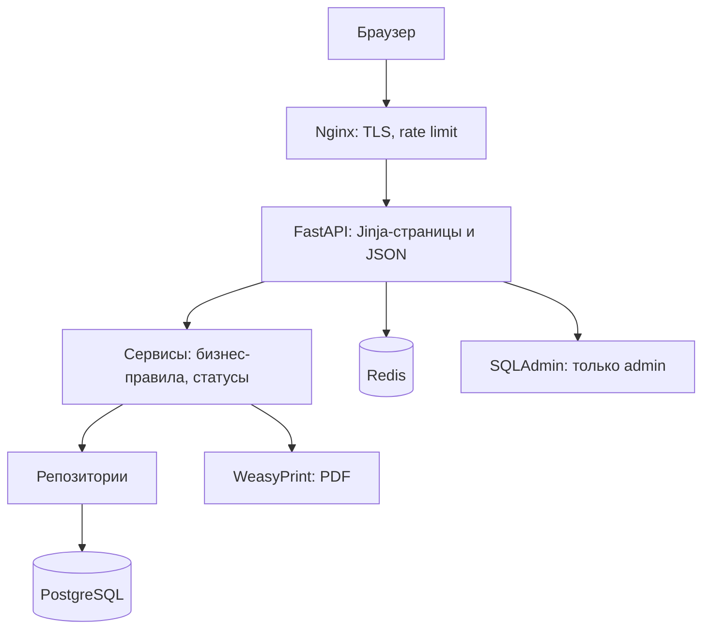

# 02. Архитектура

*Черновик v0.1, 26.10.2026.*

## 1. Стиль: модульный монолит

Одно приложение, разбитое на независимые модули с чёткими границами. Для MVP это оптимальный вариант: пять человек в команде, один сервер, общая транзакционная база. Распределённая архитектура здесь была бы преждевременной: она добавляет сложность (сеть, согласованность данных, развёртывание), а выгоды не даёт. Границы модулей проводим так, чтобы при росте их можно было выделить в отдельные сервисы.

## 2. Стек

| Слой | Технология | Зачем |
| --- | --- | --- |
| Веб-сервер / прокси | Nginx | TLS, раздача статики, ограничение частоты запросов |
| Приложение | FastAPI (Python), async | Быстрые асинхронные ручки |
| Шаблоны | Jinja2 | Серверный рендер страниц, без SPA |
| ORM | SQLAlchemy 2.x (async) | Работа с БД |
| База данных | PostgreSQL | Реляционные данные, ограничения целостности |
| Миграции | Alembic | Версионирование схемы |
| Кэш и счётчики | Redis | Rate limit, отзыв токенов, кэш слотов |
| PDF | Jinja2 (HTML/CSS) + WeasyPrint | Заключения на лету, без хранения файлов |
| Контейнеры | Docker, docker-compose | Единообразное развёртывание |
| Тесты | pytest, Locust | Интеграционные и нагрузочные |

## 3. Схема

## 4. Почему Redis

Три конкретные задачи:

1. Счётчики ограничения частоты запросов, общие для всех воркеров.
2. Отзыв (блэклист) refresh-токенов.
3. Кэш свободных слотов расписания.

В перспективе — очередь для фоновой генерации PDF и уведомлений.

## 5. Слои внутри приложения

1. **Представление**: страницы (Jinja) и API-ручки. Только приём запроса, проверка роли, вызов сервиса.
2. **Сервисы**: вся бизнес-логика, правила переходов статусов, проверки допуска.
3. **Репозитории**: доступ к данным. Базовый абстрактный репозиторий с общими операциями и наследники под сущности (наследование и полиморфизм). Запросы живут только здесь.
4. **Модели**: описание таблиц SQLAlchemy, ограничения целостности.

Правило: ручки не ходят в БД напрямую, репозитории не содержат бизнес-правил.

## 6. Модули

| Модуль | Ответственность |
| --- | --- |
| auth | Вход, JWT, refresh, ограничение попыток |
| users | Пользователи, роли, профили |
| reference | Справочники: виды спорта, специальности, виды осмотров, программы |
| schedule | Слоты врачей, запись (appointments) |
| cases | Дела на обследование, переходы статусов |
| examinations | Осмотры и нагрузочные тесты |
| conclusions | Заключения, PDF |
| audit | Журнал действий, история статусов |
| admin | Админка |

## 7. Развёртывание

- Контейнеры: nginx, app, postgres, redis.
- Конфигурация и секреты через переменные окружения, без хранения в репозитории.
- Отдельное окружение для нагрузочного тестирования (staging): своя БД с синтетическими данными (см. 09).
- MVP живёт на локальной машине. Для замеров предела берётся сервер целевой конфигурации (ориентир: VPS около 1000 ₽ в месяц).

## 8. PDF

Заключение собирается на сервере из данных в БД: шаблон HTML и CSS превращается в PDF по запросу через WeasyPrint. Файлы не хранятся, поэтому **данные заключения обязательно хранятся в БД** (таблица `conclusions`). PDF — самая CPU-ёмкая операция, на неё ставим отдельное жёсткое ограничение частоты и отдельно измеряем в нагрузочных тестах. Тут же естественное место для будущей очереди.

## 9. Админка

Берём готовую: SQLAdmin (решение принято). Рабочие экраны регистратуры и врача пишем сами на Jinja. Ограничения для админки:

- рабочие таблицы (дела, осмотры, заключения) только на чтение;
- редактирование — справочники и пользователи;
- доступ только роли «администратор»;
- действия в админке пишутся в журнал.

Причина: админка работает в обход сервисного слоя, то есть мимо машин состояний и аудита.

## 10. Что проверить при реализации

- WeasyPrint: корректный рендер кириллицы и выбранного шрифта, скорость на целевом сервере.
- SQLAdmin: совместимость версии с SQLAlchemy 2.x (async).